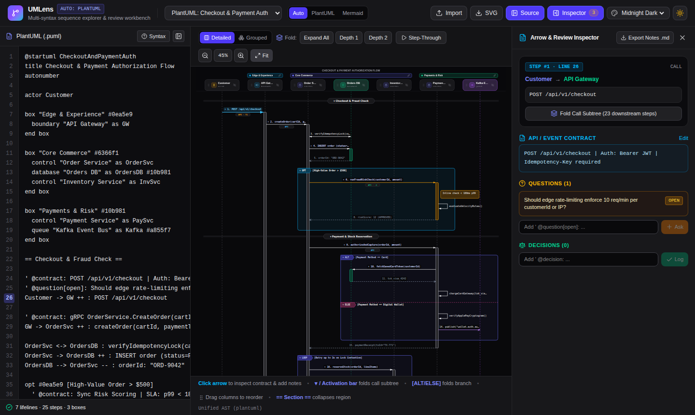

# UMLens

**An interactive, client-side sequence diagram explorer and architecture review workbench for PlantUML and Mermaid.**

[**User Guide →**](docs/USER_GUIDE.md) · [**Contributing & Developer Guide →**](CONTRIBUTING.md) · [**Example Diagrams →**](examples/)



---

## What It Does

Large sequence diagrams quickly become unreadable as static images. **UMLens** parses **PlantUML** (`.puml`) and **Mermaid** (`.mmd`) source directly in your browser into an interactive SVG canvas so you can fold away detail, focus on specific services, and annotate architectural decisions right inside your diagram source.

Everything runs locally in the browser—no external rendering server required.

### Core Capabilities

- **Dual-Syntax Support:** Auto-detects **PlantUML** and **Mermaid** sequence diagrams (or switch manually via `Auto | PlantUML | Mermaid`).
- **Group Rollups:** Click any `box` header—or toggle **Detailed / Grouped**—to collapse participant groups into summary columns while coalescing internal calls.
- **Lifeline Focus & Reordering:** Hide noisy lifelines (replaced with compact stub pills and coalesced interaction badges) or drag columns to rearrange the flow.
- **Multi-Level Folding:** Collapse call subtrees (**Depth 1 / Depth 2** or click `▾` / activation bars), fold individual `alt`/`else`/`opt`/`loop`/`par`/`critical` branches, and collapse entire `== Section ==` divider regions.
- **Step-Through Mode:** Walk through complex flows message by message with `←` / `→` keyboard controls.
- **UML Syntax Colors & Themes:** Respects explicit `#hex` / `rgba(...)` styling in PlantUML and Mermaid across 5 built-in themes (**Midnight Dark**, **Crisp Light**, **Nordic Slate**, **Warm Paper**, **Emerald Studio**).
- **In-Source Review Annotations:** Click any arrow to inspect or edit `@contract`, `@question[open|resolved]`, and `@decision` metadata stored as standard diagram comments (`'` or `%%`), and export review notes to Markdown.
- **Full-Width Workspace & Export:** Collapse either the left source editor or right inspector drawer, import `.puml`/`.mmd`/`.md` files, export the current explored SVG, or install UMLens as an offline-capable desktop PWA.

---

## Quick Start

```bash
npm install
npm run dev
```

Open `http://localhost:3000` in your browser, pick one of the built-in samples, or import a diagram from [`examples/`](examples/):

- [`examples/checkout-payment-auth.puml`](examples/checkout-payment-auth.puml)
- [`examples/order-fulfillment-pipeline.mmd`](examples/order-fulfillment-pipeline.mmd)

---

## Documentation

- **[User Guide](docs/USER_GUIDE.md)** — Walkthrough of interactive controls, supported PlantUML/Mermaid syntax, review comment tags, SVG/Markdown export, and PWA installation.
- **[Contributing Guide](CONTRIBUTING.md)** — Repository layout, unified AST & layout engine architecture, build/lint scripts, and GitHub Pages deployment.
