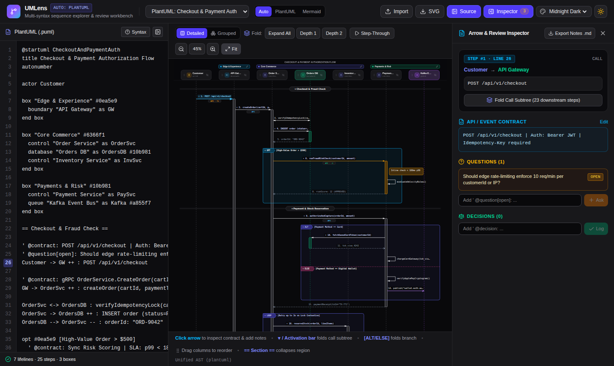
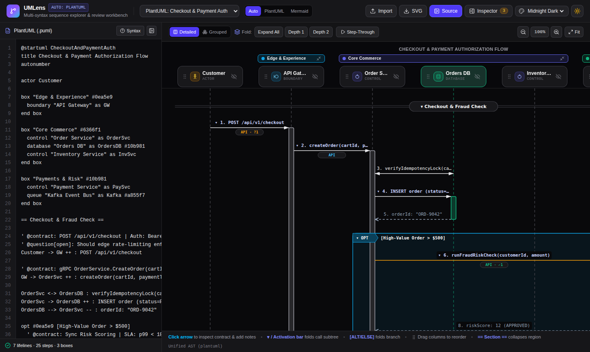
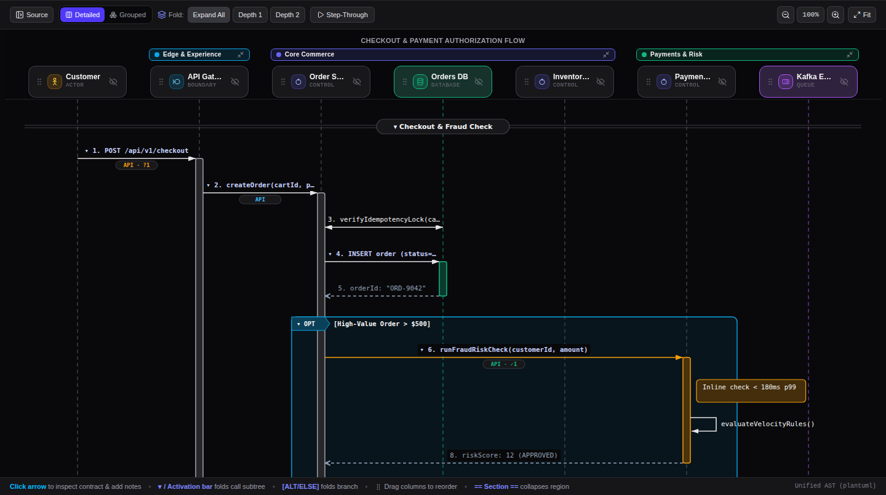
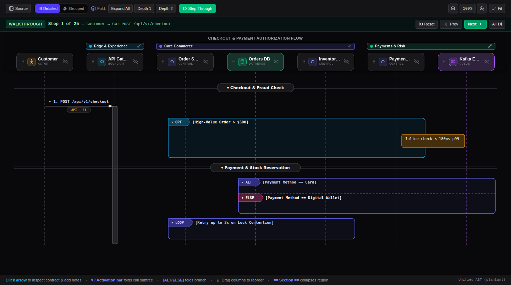

# UMLens User Guide

[← Back to README](../README.md) · [Developer & Contributing Guide →](../CONTRIBUTING.md)

UMLens is designed for exploring, presenting, and reviewing complex sequence diagrams without editing your underlying architecture source unless you want to add review annotations.



## Table of Contents

- [1. Loading & Writing Diagrams](#1-loading--writing-diagrams)
- [2. Interactive Exploration Controls](#2-interactive-exploration-controls)
  - [Group Box Rollups](#group-box-rollups-box--end-box--box--end)
  - [Lifeline Hiding & Reordering](#lifeline-hiding--reordering)
  - [Call-Tree & Depth Folding](#call-tree--depth-folding)
  - [Fragment Branch Folding](#fragment-branch-folding-alt--else--opt--loop--par--critical)
  - [Section Divider Folding](#section-divider-folding--section-)
  - [Step-Through Presentation Mode](#step-through-presentation-mode)
  - [Zoom & Fit](#zoom--fit)
- [3. Themes & Explicit UML Colors](#3-themes--explicit-uml-colors)
- [4. Architecture Review Annotations & Inspector](#4-architecture-review-annotations--inspector)
- [5. Exporting & Installing as a Desktop App (PWA)](#5-exporting--installing-as-a-desktop-app-pwa)

---

## 1. Loading & Writing Diagrams

- **Built-in Samples:** Use the sample dropdown in the top bar to switch between preloaded PlantUML and Mermaid showcases.
- **Live Editing:** Edit directly in the left source pane. UMLens auto-detects whether the source is **PlantUML** or **Mermaid** (you can override this with **Auto | PlantUML | Mermaid**).
- **Import Files:** Click **Import** in the top bar to load `.puml`, `.plantuml`, `.mmd`, `.mermaid`, `.txt`, or `.md` files from disk.
- **Full-Width Exploration:** Click the collapse button in the source editor header (or **Source** in the top bar) to hide the editor and give the diagram canvas full horizontal width. Click **Source** on the left side of the canvas toolbar (or in the top bar) to bring it back.



---

## 2. Interactive Exploration Controls

All folding, hiding, and reordering actions are **non-destructive**—they change the visual exploration view without altering your diagram source code. Click **Reset (N)** in the canvas toolbar at any time to restore the full view.

### Group Box Rollups (`box ... end box` / `box ... end`)
- **Collapse a single group:** Click any group banner above the participant headers to roll that group's members into a single summary column. Click the dashed group banner again to expand it back.
- **Collapse or expand all groups:** Use the **Detailed | Grouped** toggle on the canvas toolbar.
- Messages exchanged strictly *between* members of a collapsed group are coalesced into a compact `N internal interactions` pill.



### Lifeline Hiding & Reordering
- **Hide a lifeline:** Click the eye icon in a participant header to hide that column.
  - Messages between a visible lifeline and a hidden lifeline become compact **stub pills**.
  - Consecutive messages between two hidden lifelines coalesce into a summary cluster badge (click it to restore those lifelines).
- **Reorder lifelines:** Drag any column header using its grip handle and drop it onto another column position to untangle crossing arrows.


### Call-Tree & Depth Folding
- **Fold a specific call subtree:** Click any `▾` call label pill or its vertical activation bar to collapse its nested calls and return into a `▸ ... (+N)` summary row. Click again to expand.
- **Quick depth presets:** Use **Expand All**, **Depth 1**, or **Depth 2** in the canvas toolbar to fold deep call chains globally.

### Fragment Branch Folding (`alt` / `else` / `opt` / `loop` / `par` / `critical`)
- Click any fragment pentagon flag or branch header (`ALT`, `ELSE`, `OPT`, `LOOP`, `PAR`, `AND`, `CRITICAL`, `OPTION`) to fold or expand that specific branch cleanly.

### Section Divider Folding (`== Section ==`)
- In PlantUML diagrams, click any `▾ Section` divider pill to collapse all interactions, notes, and fragments in that section down to the next divider (or end of the diagram).
- Activation bars that span *across* a collapsed section remain anchored accurately at the collapsed divider line.


### Step-Through Presentation Mode
- Toggle **Step-Through** in the canvas toolbar to reveal the diagram progressively from step `0` to `N`.
- Navigate using the playback bar controls or the **`←` / `→` arrow keys**.



### Zoom & Fit
- Use **Zoom Out**, percentage reset (`100%`), **Zoom In**, or **Fit** on the right side of the canvas toolbar.

---

## 3. Themes & Explicit UML Colors

Switch between **5 built-in themes** using the palette selector (or the quick dark/light toggle):
- **Midnight Dark**
- **Crisp Light**
- **Nordic Slate**
- **Warm Paper**
- **Emerald Studio**

When your diagram source specifies explicit colors (`#hex` or `rgba(...)`), UMLens preserves them on top of the active theme:

| Element | PlantUML Syntax | Mermaid Syntax |
| :--- | :--- | :--- |
| **Group Box** | `box "Core Commerce" #6366f1` | `box rgba(99, 102, 241, 0.14) Order & Warehouse` |
| **Participant** | `database "Orders DB" as OrdersDB #10b981` | — |
| **Message Arrow** | `A -[#f59e0b]> B : label` | — |
| **Activation Bar** | `A -> B ++ #f59e0b : call()` / `activate B #f59e0b` | — |
| **Fragment / Branch** | `opt #0ea5e9 [High-Value]` / `else #ec4899 [Wallet]` | — |
| **Highlight Band** | — | `rect rgba(56, 189, 248, 0.08)` |
| **Note** | `note right of B #f59e0b : text` | — |

---

## 4. Architecture Review Annotations & Inspector

Click any message arrow on the canvas to open the right-hand **Arrow & Review Inspector**.

UMLens stores review metadata as standard source-code comments directly above the message line (`'` in PlantUML, `%%` in Mermaid), so annotations stay version-controlled with your diagram:

```plantuml
' @contract: POST /api/v1/checkout | Auth: Bearer JWT | Idempotency-Key required
' @question[open]: Should edge rate-limiting enforce 10 req/min per customerId or IP?
' @decision: Run synchronous fraud check inline for orders > $500
Customer -> GW ++ : POST /api/v1/checkout
```

From the Inspector drawer you can:
- Edit the arrow's `@contract` specification.
- Add, resolve, or reopen `@question[open]` / `@question[resolved]` items.
- Record `@decision` entries.
- Click **Export Notes .md** to download a structured Markdown review summary of all contracts, open/resolved questions, and decisions across the diagram.

---

## 5. Exporting & Installing as a Desktop App (PWA)

### Exporting SVG
Click **SVG** in the top header bar to download the currently explored canvas (respecting active theme, folded sections, hidden lifelines, and collapsed groups) as a standalone `.svg` file.

### Installing as a Chrome / Edge App
UMLens ships as a Progressive Web App (`vite-plugin-pwa` with `autoUpdate`):
1. Open the deployed site in Chrome or Edge and click the **Install** icon in the address bar.
2. Once installed, you can open `.puml`, `.plantuml`, `.iuml`, `.mmd`, and `.mermaid` files with UMLens via OS file associations (`file_handlers`).
3. When a new version is deployed, reload the installed app (`Cmd+R` / `Ctrl+R`, or reopen it after a refresh) so the updated service worker activates.
